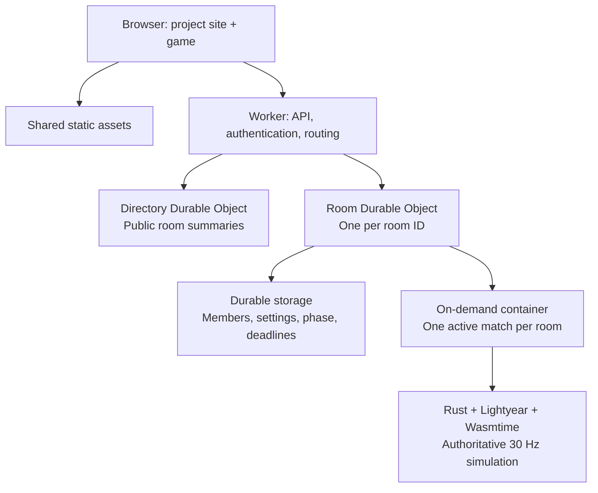
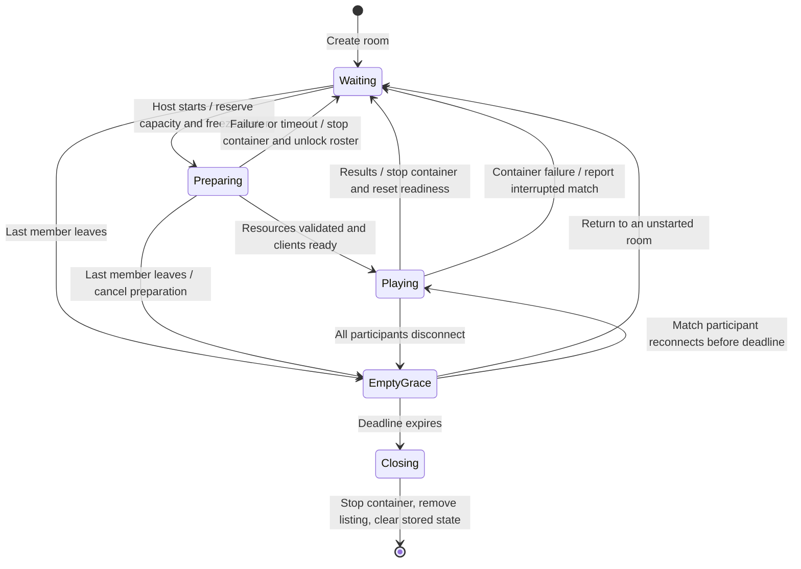
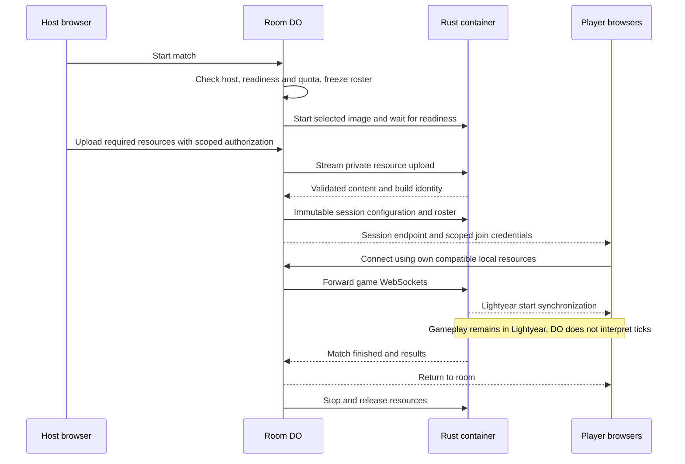
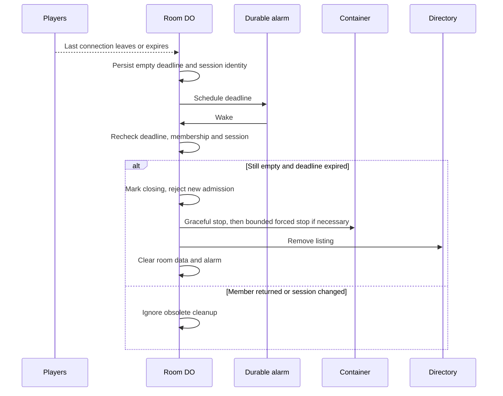

# Cloudflare multiplayer architecture

Standalone GitHub Pages play and the local Rust server remain supported.

## Components

| Owner | Authority |
| --- | --- |
| Directory | Discoverability; never grants a player slot |
| Room | Membership, host, readiness, settings, admission, container lifecycle |
| Rust | Match simulation, accepted input, rollback protocol, reconnect state, results |
| Cloudflare | Placement, object activation/hibernation and container execution |

The directory is an expiring index, not a second source of membership state.
Joining always checks the room. Catalog reads never start a container.

## Room lifecycle

- Waiting: no container; room WebSockets use hibernation.
- Playing: roster is fixed; only existing participants may reconnect.
- Empty-match grace retains the running match for reconnects. Proposed grace:
  120 seconds, configurable. Its expiry ends the match, not merely its visibility.
- A room alarm checks persisted deadlines and current membership before cleanup.
  Returning players invalidate the old deadline.
- Host departure in Waiting transfers ownership to a remaining member.
- Match results return remaining members to the same room; a new match gets a
  new session ID and fresh container process.

## Starting a match

The host uploads only to the private simulation setup endpoint. Each client reads
its own disc locally. No game assets are included in the container image, public
static assets or player downloads. Stream uploads without buffering whole images
in the Durable Object. After container removal, the next match needs a fresh
upload; persistent resource caching is outside this first version.

## Releasing resources

Cleanup and start requests must be idempotent. Late results, reconnect credentials
and exit notifications are scoped to the session ID. Directory entries expire if
cleanup cannot notify it. Container inactivity timeout is a fallback, not the
membership policy: status polling must not keep an empty match alive indefinitely.

## Resource policy

- Candidate container: **0.25 vCPU, 256 MiB RAM, 2 GB disk**. Validate on Cloudflare;
  increase CPU if the eight-player workload cannot sustain 30 TPS.
- Bound active containers globally, room creation per user, preparation time,
  upload size and empty grace. Reserve capacity before startup; release on every
  failure/exit path. Connected but unready users must not hold preparation forever.
- Keep simulation traffic out of durable storage. Persist room transitions, not
  per-tick input or positions. Enable hibernation only where eligible; active game
  proxy connections may keep the object awake.
- Container files are temporary. Durable room metadata survives a restart;
  running match recovery after container loss is not promised in this version.
- Resource measurements and sizing limitations: [server capacity](server-capacity.md).

## Transport constraint

Cloudflare Containers use **WebSocket** for game connections in this architecture.
Lightyear 0.30.1 supports WebTransport, but the Worker/Durable Object ingress path
currently does not support incoming WebTransport sessions (checked 2026-11-12).
Enabling the Lightyear feature alone does not remove this hosting limitation.

To use WebTransport, keep the site and room on Cloudflare and host match servers
on infrastructure with public UDP/QUIC ingress. Browsers connect directly to those
servers; the room returns their endpoints and scoped admission credentials.

References: [Lightyear WebTransport](https://docs.rs/lightyear/0.30.1/lightyear/webtransport/server/index.html),
[Cloudflare support discussion](https://github.com/cloudflare/workerd/discussions/6454).

## Implementation boundary

The implemented slice provides the public room directory, creation/joining,
host settings, participants and invite links. Creation asks only for the player
and room names; the server supplies Deathmatch, Construction Yard and eight slots.
The host can edit those settings inside the room while others join. One room
Durable Object owns admission and permissions; the directory contains only expiring public summaries.
A private browser credential restores membership across reloads and tabs without
appearing in listings or invite URLs.

Room sockets hibernate. Persisted disconnect and empty deadlines bound reconnect
and cleanup; host departure transfers ownership. An expired empty room first
removes its directory summary, then closes sockets, calls `deleteAll()` and clears
memory. Directory-removal failures retain a future retry deadline; stale summaries
also expire independently. Explicit creation tickets expire before empty cleanup,
so old requests cannot recreate deleted rooms without leaving tombstones.

Ready/start controls, resource upload and the Preparing/Playing transitions above
remain future work. Room operations do not address a simulation container.
The existing `TestServer` Durable Object class, namespace declaration, container
binding, Docker build and health collector are retained for server integration;
the Worker does not expose the replaced single-test-server API.
No existing namespace is retired by this slice. Local Bun hosting continues to
serve `apps/server` with the API provided by a separate Rust process.

Cloudflare references: [container lifecycle](https://developers.cloudflare.com/containers/concepts/architecture/),
[WebSocket hibernation](https://developers.cloudflare.com/durable-objects/best-practices/websockets/).
