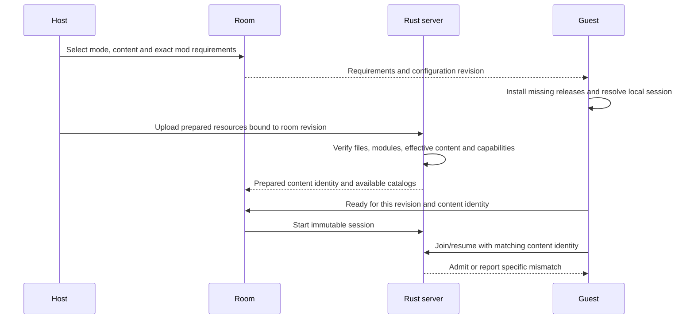

# Mod library, installation and session content

Design proposal, 2026-11-23. This describes the target system, not shipped support.
TM3 is the first end-to-end integration. Existing car-package formats, storage
records and activation APIs need no compatibility layer. Evelyn may be retired;
it must not introduce a special case into the new contract.

## Product boundary

`/mods/` is the shared entry point for discovery and the local installed library.
A curated catalog initially ships with the site; no account, marketplace backend,
public submission workflow or arbitrary remote UI plugins are needed.

A catalog card describes the mod, its contents, supported uses and installation
method: download a ready package or build it locally from required resources.
An installed card shows its release, size, enabled state and any blocking reason.
Actions are install/build, enable, disable, update and remove. Updates are explicit.
An unknown but valid local package can be installed without a catalog entry.
Catalog availability is not required to play an already installed package.

The player links to this section and displays its session's content. It no longer
owns a second package picker, database or independently editable selection.
Standalone player hosting can expose the same library UI through the shared
library service, without duplicating installation rules.

Three concepts have distinct owners:

| Concept | Meaning | Owner |
| --- | --- | --- |
| Installed release | Verified immutable files are stored in this browser | Local library |
| Enabled selection | User's default content for solo play and creating a room | Local preferences |
| Session content | Exact resolved content used by this running game | Launch plan; server for network play |

Installed does not imply enabled. Enabled does not imply permitted by a room.
Changing defaults never mutates a running game. Joining a room does not change solo
defaults. Multiple tabs can run different immutable session selections.

## What exists and what changes

| Current implementation | Decision |
| --- | --- |
| `apps/player/src/state/mods.ts`: `selected` and `active` arrays of `CarMod` | Replace with shared library state and explicit session resolution |
| `apps/player/src/mods/storage.ts`: whole-list replacement keyed only by mod ID | Replace with immutable release records, staged files and transactional preferences |
| `packages/resources/src/mods/package.ts`: one car, versions 1/2, 4 MiB limit | Replace package contract; no legacy reader or migration adapter |
| `packages/resources/src/mods/install.ts`: car-specific mutation of a session copy | Retain useful preview/MR helpers; replace installation entry point with generic content assembly |
| `apps/player/src/main.ts`: all mods disabled for network games | Resolve the room's exact set before engine startup |
| `port/web/net_match.c`: checkpoint startup rejects any mod | Replace only after per-release network validation and snapshot coverage are in place |
| MR loader, module identities, resource preparation, object/snapshot interfaces | Reuse; extend shared contracts where needed |
| Engine-native car selection and `modes/` ownership | Preserve; content changes catalogs, not who owns mode rules |

[Existing engine contracts](mod-effects.md) continue to describe gameplay and
resource lifetime. The library must not duplicate those mechanisms.

The current [TM3 builders](https://github.com/ediskandarov/rusty-metal-4-tm3-mod)
are CLI tools. Shared resources use TM4 reflection textures; map conversion uses
TM4 pickup resources. They invoke Emscripten and validate imports against the
browser build. Browser installation and authoritative-server support are **new
work**, not a UI wrapper around a ready browser installer.

## User journeys

### Build and enable TM3

1. Open Mods → TM3 → Build from disc. Show the supported disc/data revision and
   what will be installed before asking for files.
2. Select the TM3 disc folder. Reuse verified TM4 resources from the current load
   when available; otherwise request the required TM4 source too. The current
   converter genuinely needs both. Do not pretend that TM3 replaces the base game.
3. Validate only required source resources. Optional custom music is not an
   installation identity check. The original source images are never modified.
4. Run conversion in a worker with progress and cancellation. Combine converted
   data with pinned, precompiled module artifacts; do not compile C in the browser.
5. Validate the complete result and proposed enabled selection. Commit installation
   and activation together, then report “TM3 installed and enabled”.
6. Show its verified cars/maps and, once implemented, the TM3 campaign entry.
   Loading TM3's source disc is no longer needed to reuse the installed result.

If installation fails or is cancelled, the previous installation and selection
remain usable. If enabling conflicts with another selection, resolve that conflict
before reporting success; do not silently disable unrelated mods.

The saved package includes the derived resources needed from both source discs.
It does not cache entire source discs. Playing still requires the base TM4 resources
as today; persisting the full base game or optional music is separate work.

### Solo play

`/play/` becomes a launch surface with stock play and campaign/content entries
provided by the enabled selection. Choosing an entry resolves and freezes a launch
plan, obtains base resources and starts the engine. Car and map choice stay in the
engine. A launch entry selects a campaign/catalog, not a replacement web car picker.

Changing mods during play takes effect on the next launch. Recreate the runtime
when its content set changes; do not unload mod code inside a live C world.
The existing iframe boundary need not be removed to deliver this system.

### Network room

The host chooses from the enabled content supported by the selected network mode.
A room can explicitly require TM3 even when playing an otherwise stock map. Default
to the dependencies of the chosen content, not every mod installed by the host.
Display required mods before resource loading or Ready, with actionable reasons:
missing release, disabled locally, incompatible engine, different data or unsupported
network behavior. A locally disabled but installed required mod can be used for the
room without changing the user's defaults.

A guest with missing content follows the installation flow and returns to the room.
Installing a mod does not reserve a game slot. Existing admission/recovery rules
still decide whether the participant can enter after preparation finishes.

A settings/mod change invalidates readiness and any prepared server based on the
old revision. A slow upload or stale iframe response cannot ready the new revision.
After start, content is frozen until the match ends, including all tournament stages.
Late join and reconnect use the same pinned set. A browser update cannot silently
upgrade it; unavailable old builds/releases produce a clear incompatibility result.

## Package and identity contract

Use one new `.tm4mod` format: ZIP containing `manifest.json`, resource files and
precompiled modules. JSON describes packaging and web discovery; gameplay data,
bindings, effects and campaign resources remain MR. The C engine never reads ZIP
or the library's JSON. Existing ZIP tooling can be reused. Bound compressed size,
total expanded bytes, individual file size and entry count before allocating output;
reject duplicate/escaping paths and unsupported entry types. Replace the old car-sized
limit with explicit package/target limits, not unlimited extraction.

The envelope supports a pack of cars, maps, shared resources and campaigns rather
than a `kind: car` restriction. Optional dependencies, arbitrary patch scripts and
user-controlled override ordering are excluded from the first format.

Define strict Zod schemas in `@tm4/mods`. These are the contract sections, not a
second copy of future schema declarations:

| Section | Purpose |
| --- | --- |
| Format version | Version of the package schema, separate from release version |
| ID and release | Stable namespaced mod ID, human-facing release label |
| Engine requirement | Explicit module/resource ABI identity and required extension versions |
| Dependencies | Required exact release identities; acyclic graph |
| Contents | Stable namespaced IDs and labels for cars, maps, campaign references |
| Resource mounts | Bounded package paths and explicit engine destinations/registry bindings |
| Modules | Symbol identity, hashes, imports and browser/authority artifacts |
| File inventory | Path, size and hash for every payload; reject unlisted files |

A public catalog entry additionally owns description, images, supported source
revisions, download/build recipe and links. It is not trusted proof that a local
installation matches those bytes. Import provenance is stored locally for diagnostics,
not used as an alternative to content verification.

For example, `tm3:sweet-tooth` and `tm4:sweet-tooth` are different car IDs with
independent labels. Long public IDs do not go directly into fixed-size engine names.
Assembly resolves them to deterministic bounded registry aliases and file names,
rejects collisions, and shares that mapping between browser and authority. Array
indices and translated labels are never persistent content identity.

Distinguish these hashes:

- **Release digest:** canonical manifest plus sorted file inventory and file hashes,
  excluding its own digest, installation timestamps and ZIP metadata. Includes both
  target module variants. A repacked ZIP with identical payload has the same identity.
- **Session content digest:** ordered dependency closure, effective resource bindings,
  verified base gameplay content and module release identities. Computed from a
  common logical manifest before target-specific Wasm substitution, then checked
  against the chosen target's actual bytes.
- **Runtime build identity:** existing browser/authority build compatibility remains.
  Package compatibility uses a declared engine ABI, not the site's Git commit.

Version text alone never grants a network match. Initially require exact release
and effective content digests; do not promise that visually different packages are
network-compatible. Existing exclusions for optional music remain explicit.

Browser and authority artifacts can share bytes when genuinely compatible, but both
must pass their target's import and execution checks. Do not compare unlike target
binaries as though they should hash identically. Module names may not collide with
stock or other active modules. Hashes prove content identity, not safety or determinism.

## Deterministic composition and capabilities

Resolve dependencies first, then independent roots by canonical ID; the UI's click
order must not affect registry layout or checksums. One version of an ID can be used
per session. Several versions may remain installed for pinned rooms/saves.
Reject missing dependencies, cycles, duplicate content IDs and conflicting writes.
No silent last-writer-wins overlay. A deliberate replacement must name its target
and expected base identity; two replacements of the same target conflict.

Separate assembly order from gameplay resource lifetime: the engine still loads game
resources, then world, then cars. Preserve virtual sector layout between browser and
headless preparation, including client-only file spans, as the existing MR preparer does.

Features are derived from **resolved, usable content**, the selected target and
registered engine/mode support. No stored `hasTm3` flag and no generic `network: true`
boolean that unlocks every mode. Availability is scoped to a launch entry or mode:
a car pack may work with FFA while a campaign remains solo-only.

A campaign contribution points to an MR campaign definition and a supported campaign
runner. The definition owns map order, roster and other supported campaign data;
the runner owns transitions, carries and completion. Keep runners under the mode
modules. Do not turn the library into a scripting engine or copy tournament rules
into TypeScript UI selectors. TM3 campaign support must implement and test its actual
rules; existing TM3 map conversion alone does not provide it. Unsupported runners
cannot become enabled merely because a manifest names them.

Known recipes and launch handlers are shipped application code, registered by typed
ID. Packages cannot inject JavaScript, HTML settings panels or arbitrary converter
URLs. New gameplay behavior uses the existing resource-module interfaces. New kinds
of web feature need a deliberate handler, not an unbounded feature-flag dictionary.

## TM3 repository boundary

Extend the mod contract rather than teaching the core library to recognize TM3:

- Extract reusable, browser-safe conversion functions taking a random-access disc
  reader and verified resource/artifact sources. CLI commands become thin wrappers
  around the same functions; remove `Bun`, filesystem and compiler calls from the core.
- Keep TM3 revision checks, source paths, car/map conversion, resource bindings,
  shared pack generation and campaign definitions in the TM3 repository.
- Publish versioned converter bundles and precompiled module releases through the
  site's pinned, reviewed recipe integration. Only code/metadata without source-disc
  assets is public; generated packages stay local until a host prepares a server.
- Build target artifacts ahead of time against the declared engine ABI. Verify both
  browser and authority exports/imports; add real cross-runtime tests before claiming
  multiplayer support. The current browser-only compile check is insufficient.
- Expose progress, cancellation and a list of required input resources. Bound output
  is identical for identical inputs, converter release and module artifacts.

The generic recipe interface has three operations: inspect sources, build into a
staging sink, and validate the output manifest. The installer, not the recipe, owns
publishing the completed installation and changing the enabled selection.

This is an application build integration with the TM3 converter package, not a
filesystem dependency on a developer's neighboring checkout or a special game build.
A successful site deployment preserves installed mod data. An actual ABI break may
require a new module release or rebuilding the package; no legacy runtime is promised.
Keep old installed artifacts until the user chooses to remove them.

## Browser storage and state

Use IndexedDB initially for metadata and file `Blob`s, with a new database/schema.
Do not reuse the old `tm4-rewired-mods` records or silently convert Evelyn packages.
The obsolete library can be explicitly cleared; it cannot participate in new launches.
OPFS can be evaluated after measuring full TM3 package sizes, without making a second
storage implementation part of the first delivery.

Write converted files incrementally under an installation/job ID. Hash/validate them
before the short publication transaction, which marks the release complete and updates
the enabled selection. Do not keep an IDB transaction open across conversion or fetch.
Readers only see completed installations. Cancellation/crash leaves unpublished staging
files for cleanup; updating never deletes the working release before replacement succeeds.

Use a revision check in the publication transaction to prevent lost preference updates
from another tab. Concurrent installation of the same digest is idempotent. Broadcast
an invalidation/revision after commit; each context reloads metadata from IDB. A shared
package does not mean that separate pages/iframes share a JavaScript store instance.
Do not broadcast package bytes or a replacement session plan.

A launch pins its selected files while obtaining the runtime's owned resource copy.
Removal must not break a pending launch; loaded sessions keep their copy. Removing a
required dependency is blocked unless its dependents are disabled/removed together.
New installs and updates do not evict old releases merely because a running room uses
a different version. Automatic release garbage collection is deferred.

Zustand owns library metadata, enabled roots, per-installation progress and errors.
Large binaries remain in storage/staging, outside reactive state. One shared library
service supplies pages and player views; room and startup stores retain their own
lifecycle and refer to a resolved content plan. Available entries, dependency closure,
conflicts and “restart required” are selectors, not duplicated writable fields.

Request persistent storage after an explicit installation action; show an ordinary
failure if quota is insufficient and offer removal/export. Browser persistence is
not a guarantee against site-data deletion or private-session closure. Installed
resources are scoped to origin/profile; localhost, another browser and a different
hosting origin have independent libraries. See [storage persistence](https://developer.mozilla.org/en-US/docs/Web/API/Storage_API/Storage_quotas_and_eviction_criteria)
and [transaction lifetime](https://developer.mozilla.org/en-US/docs/Web/API/IndexedDB_API/Basic_Terminology).

## Server preparation and admission

Extend existing preparation, not create another simulation host or mod download
channel. The host uploads the required generated gameplay resources and declared
module artifacts for the frozen content plan. The server validates hashes, ABI,
module identities, resource references and effective catalogs itself. Guest clients
supply their own compatible local content; the room is not a public source-disc server.

The public catalog initially declares which exact releases were verified for each
network mode/runtime ABI. Room selection and the container enforce that release policy;
a self-authored manifest cannot enable unreviewed server code. For locally generated
TM3 packages, this means deterministic accepted outputs for supported source revisions
and pinned converter/module releases; publishing their digests does not publish disc
assets. Broader modified-source acceptance is a separate policy. Standalone servers can
explicitly configure their allowed releases. Avoid a signature marketplace or general
trust framework in the first delivery, but keep compatibility and admission distinct.

Replace the blanket C mod prohibition only for this verified path. Required checks
include module callback/allocator lifetime, simulation randomness, snapshot type
coverage, browser/Wasmtime equivalence and fresh-instance restore. A prepared snapshot
alone cannot prove all later weapon/object paths; curated releases need scenario tests.
An unsupported live object still fails clearly through the existing checkpoint rules.

Carry the exact resolved set in room state, session setup, compatibility/join/resume
checks, server journals and diagnostic archives. Report missing IDs or wrong releases
before the generic digest mismatch when possible. The overall content digest remains
mandatory even if the listed mods match. Replay tooling must not fall back to a new
release with the same name. Next-match preparation may select a new set only after
teardown and readiness reset; recovering an old participant cannot reuse that plan.

## Proposed code ownership

| Location | Responsibility |
| --- | --- |
| New `packages/mods/` (`@tm4/mods`) | Zod package/catalog/launch contracts, hashing, dependency resolution, bounded package I/O, browser storage service and vanilla Zustand library state; separate pure and browser exports |
| `packages/resources/` | Disc/resource codecs and validation; keep format primitives independent of UI and library state |
| `packages/mr-preparation/` | Shared byte-oriented assembly and validation needed by browser and Rust; extend for generic registration/mount plans rather than duplicate TS/Rust composition |
| TM3 repository | Converter core, compiled behavior modules, resources/campaign definitions and tests; thin CLI and browser entry points |
| `apps/rustymetal4.com/src/pages/mods.astro` and mod UI/catalog modules | Discovery, installation flow, installed library; no gameplay logic |
| `apps/player/` and `packages/game-runtime/` | Obtain the immutable launch plan, prepare target assets, native menu selection and runtime lifecycle |
| Existing room store, mode modules, room-player protocol and API clients | Typed requirements, availability, configuration revisions and readiness; no duplicate package database |
| `port/extensions/` and existing C mode modules | Generic content registration/launch hooks if needed; campaign execution stays with its mode |
| Rust management/simulator/protocol and room worker | Verified preparation, admission and pinned session identity |

The engine consumes MR and ordinary modules, not catalog cards or mod IDs such as
TM3 hardcoded into its generic paths. Share cross-language resource processing through
the existing Rust/Wasm preparer; validate external JSON strictly with Zod on web
boundaries and corresponding Rust types on authority boundaries, with common fixtures.

## Delivery order and acceptance

| Stage | Deliverable | Required proof |
| --- | --- | --- |
| 1. Library foundation | New format, exact identity, storage, enable/disable, resolver and `/mods/`; retire old car-only UI/API | Ready package survives reload; corrupted/oversized package, conflicting mount, dependency cycle, quota failure, cancellation and concurrent updates preserve the previous usable state |
| 2. TM3 installation | Shared converter core, prebuilt modules, browser worker recipe; install and enable cars/maps | Build from supported discs, close/reopen page, launch from saved package without TM3 source; equivalent CLI/browser output; no Emscripten or local server required |
| 3. Solo launch and campaign | Enabled-content launch catalog and actual TM3 campaign runner/definition | Native car/map choice; ordinary stock play still works; campaign advances, finishes and starts again; unavailable campaign does not appear as playable |
| 4. Room requirements | Explicit exact mod set, availability and preparation revision through room/player/API | Guest with missing/wrong/disabled required mod gets correct action; extra installed mods do not leak; changing selection invalidates old Ready/upload responses |
| 5. Modded authority | Target preparation, verified-release admission, removal of blanket prohibition for supported content | Browser/Wasmtime parity, rollback and portable restore for supported TM3 content; ownership and code-module identity checks cannot be bypassed by matching names |
| 6. Complete network lifecycle | Join/reconnect and next match with pinned sets, diagnostics | Late FFA join after installation, reconnect during transfer, match completion and next match with changed content; tournament stages retain the original set |

Stages are implementation boundaries, not promises to implement all campaign or
network combinations at once. Until stage 5 passes, TM3 is solo-only in the shipped
catalog. Network support can first cover a small verified TM3 car/map combination,
then expand explicitly; it must never imply that the full campaign is network-ready.

Additional regression scenarios: two versions of one mod in different rooms; TM3 and
TM4 cars with the same display name; source music differences; deployment with unchanged
ABI; actual ABI change; removing/disabling content used by another page; installation
while a game is running; stale preparation response after a mod change; fallback after
storage loss; forged module hashes and missing snapshot descriptions.

Defer automatic downloads for guests, cloud library sync, arbitrary browser scripts,
mode hot-loading, cosmetic-only network exemptions and general save migration. Campaign
save records must at least include campaign ID and exact content identity; incompatible
saves are reported explicitly rather than loaded under another ruleset.
