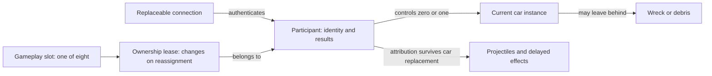
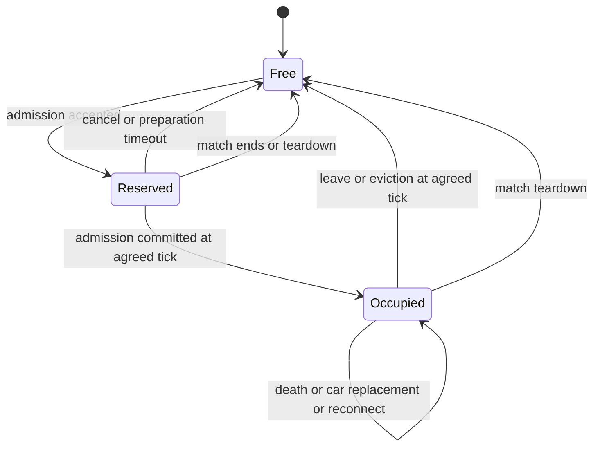
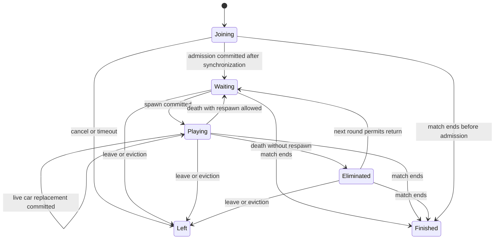
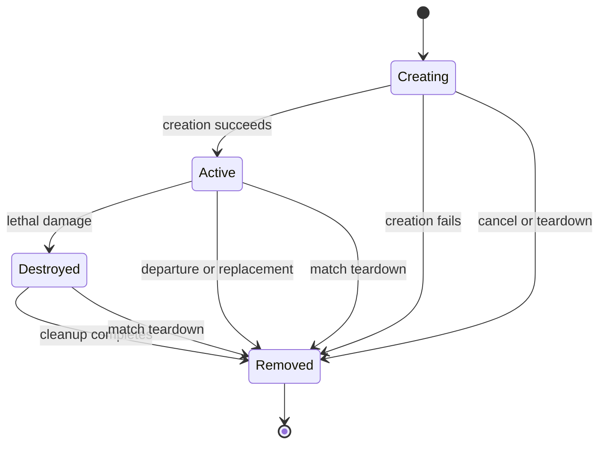
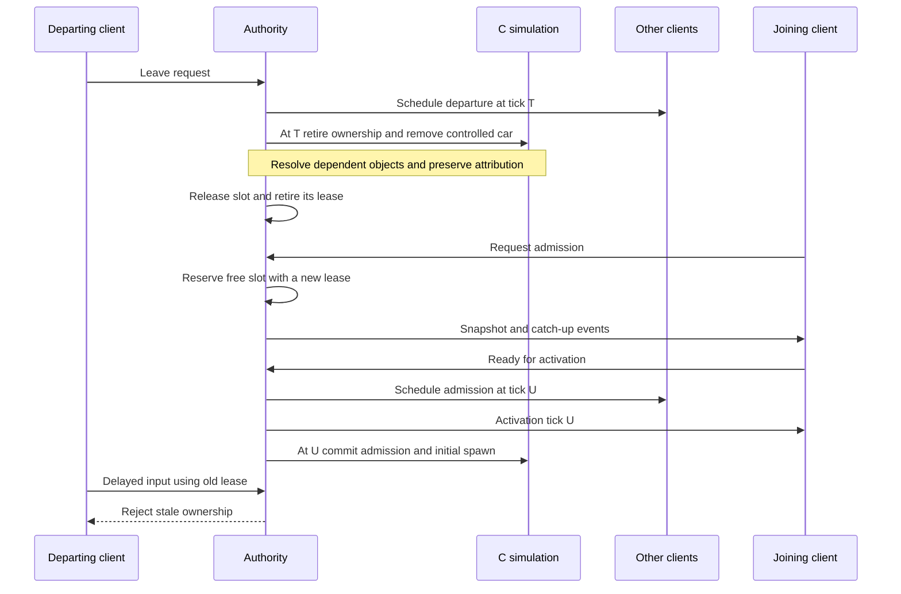

# Slots, participants and cars

Design requirements for dynamic membership. This extends the identity model in
[network requirements v0.1](../network-requirements-v0.1.md); it does not claim that
live admission or FFA is implemented. Updated 2026-11-13.

## Evidence and scope

| Status | Boundary |
| --- | --- |
| Current main | Fixed match roster, reconnect and snapshot recovery. Reconnecting an existing participant is not admitting a new one. |
| Experiment 336, not integrated | A third, preloaded slot joins, leaves and is reused in a controlled Deathmatch fixture, including rollback and snapshot recovery. This does not prove arbitrary admission, sparse slots or all object lifetimes. |
| Target | Separate identity, control ownership and car lifetime before adding live admission and mode-specific respawning. |

The first agreed new mode is FFA: eight gameplay slots and joining and leaving
during play. Car selection belongs to the mode: FFA supports a fixed car or random
selection after death, which may choose the same model again. Time and frag limits
are settings, but host editing remains disabled in the first UI. Their defaults
are undecided. Other modes below are design cases, not commitments to implement
them now.

## First FFA delivery boundary

The first network FFA uses its own round and participant rules while retaining the
original physics, weapons and collision. It does not emulate Tournament or the
original Deathmatch round organization. Standalone offline modes remain unchanged.

The approved scope is eight gameplay slots, participant-owned frags/deaths, a bounded
respawn delay, and a fresh car after death. Selection is a mode policy: fixed or
random from an agreed compatible pool; random may select the previous model. Live
admission, departure, slot reuse, reconnect, match limits and return to the room
belong to this delivery. Membership changes commit as authoritative tick events and
must survive rollback, portable recovery and journal replay. Spawn failure retains
the waiting participant, results and lease with bounded retries and a clear terminal
outcome. Time and frag defaults remain undecided; tests specify them explicitly.
Host editing of limits remains disabled in the first UI.

Live replacement of an active car, transactional preservation of that car on failed
replacement, and general transformation policies are deferred. The broader FSMs
below retain those future cases as design constraints, not first-FFA acceptance.
Tournament compatibility is not a requirement for network FFA.

This requires a change to the current portable boundary: it binds cars and cameras
to tick-zero serials and accepts only a fully living fixed roster. A new car lifetime
needs resource-backed reconstruction independently of its tick-zero object. Removing
that restriction and recording authoritative membership events are implementation
work; the FSMs alone do not provide either mechanism.

## Relationships

A slot is capacity, a participant is identity, and a car is a simulation object.
These names describe contracts, not mandated new structs or fields. A lease means
that reuse must distinguish the previous owner from the next one, even if both use
the same numerical slot. Connection credentials and a car pointer cannot provide
that distinction by themselves.

## Current fixed-roster boundary

The authority keeps match-local participant IDs and their unique gameplay-slot
bindings separately from connection, recovery and command-acceptance state.
Unauthenticated open-lobby re-entry gets a fresh participant ID; authenticated
room recovery keeps its ID.

Capacity is independent of participant count. Free slots are explicit; preparation
reservations may be cancelled and reused without renumbering other slots. The
never-reused participant ID also identifies its lease. Cancelling a reservation or
open-lobby re-entry allocates a new ID. Starting freezes all prepared bindings;
reserve/release then reject changes. This stage has no simultaneous live
reservations and occupied seats.

Preparation changes belong to the Match: retiring a binding removes its native
controller, connection authorization, credentials and input state before reuse.
The retired link closes; queued admission requests from it cannot reclaim the new
reservation while the transport finishes unlinking.
Room credentials are associated with explicit participant bindings during setup;
admission does not interpret the room member's list position as a gameplay slot.

During the running Deathmatch the binding is fixed:
authenticated recovery replaces the connection while retaining the participant,
slot, C-owned results and input sequence watermark. Credentials
authenticate an existing participant; they are not its identity.

The replicated native controller carries both participant ID and slot. Input
acceptance also checks its current controller entity and connected owner, in
addition to Lightyear's existing target authorization. Rebinding discards raw
commands left by the previous connection, without clearing accepted input history
or the sequence watermark. The client checks unique participant/slot bindings
and that its controlled slot matches its local view before prediction starts.

C simulation state, original Deathmatch round results, accepted frames and portable snapshots remain
slot-addressed under the immutable running roster. The server retains the binding
through recovery without a separate participant-results copy. Startup carries
capacity and actual occupied slots separately. C player roots, pads, camera/HUD
ownership and results use those actual slots. The existing dense car list and car
entrant index describe simulation objects, independently of controller slots.
Vacancies create no car or camera and take no part in readiness, native input
frontiers or Deathmatch results. Portable session roots validate the occupied-slot
mask and declared capacity before restoration. The C startup call requires the
complete capacity, occupied-slot and mode-car configuration; failed or cancelled
startup contributes no configuration to a later attempt.

Stable participant IDs also cross the startup boundary into C. C owns combat
counters independently of the current car; Rust and browser code do not maintain a
second score authority. The native controller bindings must match those supplied
to C. Detached weapon effects receive copied provenance explicitly; ordinary owned
children inherit their owner's identity. Timed secondary-wave callbacks capture identity
values, independently of process/interaction/destruction context. Burning retains
its source on the car after the originating effect or car disappears. Each accepted
external ignition or refresh replaces that source, including zero for environmental
fire; contact with the car's own attached flame does not refresh it. Shielded/frozen
ignitions do not change it. This is provenance for one burning interval, not an
assist or generic last-attacker system. AI damage reaction keeps its original
attacker argument. The participant-aware raw damage export has a distinct name;
the old calling convention is not silently accepted. Original Deathmatch still owns
its round wins/losses and victory rules.

This boundary does not implement FFA rules, respawn, live admission, departure,
running slot reuse or car replacement. Those require the timeline and lifetime rules
below.

## Slot FSM

`Reserved` consumes capacity while a new participant catches up. It is not a car.
A temporary disconnect keeps an occupied slot during the reconnect grace period.
Death does not release the slot. Expiry and explicit leave release it according to
the mode's departure policy, not merely when a socket closes.

## Participant FSM

Connection state is independent: connected, disconnected within grace, or expired.
A disconnected participant can still be killed or win the match. Reconnection
restores their current state; it does not revive the car or reset results.
`Waiting` includes respawn delay and waiting for an eligible round. A spectator
without a gameplay seat is a separate future policy, not an eliminated player.

`Left` and `Finished` stop participation in this match. Results and effect
attribution may outlive them. Room membership and the next match have separate
lifetimes; returning to the room must not reuse the old match's control lease.
Explicit leave followed by re-entry creates a new participant with fresh results,
even for the same person. It cannot reclaim the departed participant's identity.
This differs from authenticated recovery after a temporary connection loss.

## Car FSM

Respawning or replacing a live car starts a new logical car lifetime, even if the
implementation reuses storage. A wreck can coexist with its owner's replacement
car. Capture, stun and immobilization are gameplay conditions of an active car;
they do not transfer participant ownership.

## Composing the FSMs

These are valid committed states. Creation may be prepared internally, but partial
ownership changes must not become visible to gameplay or snapshots.

| Participant | Slot relationship | Current controlled car |
| --- | --- | --- |
| Joining | One reservation | None |
| Waiting | One occupied lease | None; old wrecks may remain |
| Playing | One occupied lease | Exactly one active instance bound to that lease |
| Eliminated | One occupied lease | None; a spectator view does not grant control |
| Left | No reservation or lease | None; attributed effects may remain |
| Finished | No reservation; an occupied slot may remain until teardown | No gameplay control; final scene objects may remain until teardown |

Admission atomically commits `Reserved → Occupied` and `Joining → Waiting` at its
authoritative tick. A successful initial spawn may enter `Playing` at that same
tick; a mode may instead keep the participant waiting for an eligible round.
Failed admission does not publish half of this transition.

Live replacement atomically changes the current car while keeping `Playing`, its
slot lease and participant identity. Until it succeeds, the old car remains the
current instance. Death transitions to `Waiting` or `Eliminated` and removes
control of the destroyed car without releasing the slot.

Explicit departure retires the lease together with control of the car. Match end
cancels pending reservations and disables gameplay control; teardown frees all
remaining slots and cancels any unfinished creation. No activation may commit
after the match has ended.

## Mode policies

| Mode | Join during play | After death | Departure consequences |
| --- | --- | --- | --- |
| FFA, agreed direction | Reserve any free seat, catch up, spawn | Keep results and slot; fixed or random car according to the mode setting | Free seat; old effects must not become the next occupant's |
| Current Deathmatch | Existing participant reconnect only | Existing game rules | Current fixed-roster behavior remains until explicitly replaced |
| Team deathmatch, candidate | Also assign a team | Preserve team and results | Preserve team results independently of occupancy |
| Capture the flag, candidate | Also assign a team | Respawn under mode rules | Resolve a carried objective before removing the car |
| Elimination or limited lives, candidate | May wait for the next round | Wait, spend a life or become eliminated | Decide forfeit and victory rules explicitly |
| Duel, candidate | Queue when both seats are occupied | Mode-specific | Decide forfeit and promotion from queue |
| Tournament, candidate | Must respect the existing stage and roster rules | Keep the assigned car model under the stage's respawn rules | Distinguish leaving a match from leaving the tournament |

Mode rules decide admission, car selection, respawn and scoring. The shared
lifecycle mechanism does not hardcode random selection or couple replacement to
death. A mod event may replace a living participant's car during play.

### Car selection and replacement

The mode chooses the model and replacement timing, including initial spawn,
respawn and live transformations. It also specifies what happens to car-local
state: health, weapons, velocity, position and active attachments. These are not
automatically copied wholesale. A car replacement itself preserves participant
identity, results, team and slot; other mode events may change those separately.

The common operation validates the model, prepares the instance, resolves dependent
references and commits the replacement at an authoritative tick. It updates the
local view without reassigning the participant. Existing projectiles retain their
original attribution. Failure leaves no partial replacement or constructor side
effects, including changes to gameplay RNG state.

Random selection may return the previous model. It uses an agreed available pool
and must reproduce the same choice after rollback, through deterministic state or
a recorded authoritative decision. Model identities must not depend on local
resource enumeration order.

Every simulating peer and the authority must have compatible gameplay resources
for that pool before a model can be used. Late admission validates the newcomer
against the active pool, not just their selected car. Extending the pool during a
match requires resource readiness before activation; it must not stall the other
players or silently substitute a model. The resource distribution constraints in
the network requirements still apply.

Failure handling distinguishes three cases:

- Failed admission abandons and releases its reservation, or retries within a
  bounded admission deadline.
- Failed respawn leaves the participant in `Waiting` with their results and
  occupied slot intact. The mode must define bounded retries and a terminal policy.
- Failed live replacement leaves the original car and its participant binding
  unchanged. A later retry is a new scheduled attempt.

## Leaving and reusing a slot

This is the target logical ordering, not a proposed wire protocol. The server
continues simulating during catch-up. Membership changes belong to the simulation
timeline, snapshots and journal so prediction can replay across them. Snapshot
recovery must include every membership event after its captured state.

## Invariants

1. A slot has at most one current owner. A participant has at most one reservation
   or occupied lease. Reserved plus occupied slots cannot exceed the mode's
   capacity; disconnected and eliminated owners still consume their seats.
2. Input is valid only for its match, ownership lease and tick. Slot reuse cannot
   make delayed input from a previous owner valid again.
3. A participant controls at most one active car in these modes. Score, team and
   reconnect identity survive replacement of that car.
4. Leaving and disconnecting are different events. A second connection must not
   accidentally create a second participant or release the first one's seat.
   After explicit departure, re-entry creates a new participant. A new occupant
   inherits none of the previous occupant's results, team assignment, input history
   or per-participant timers; the mode initializes them afresh.
5. Death and departure detach references safely. Damage attribution is not a
   dereference of a destroyed car, nor a lookup of whoever now occupies its slot.
6. Camera, HUD and audio follow the local participant's current view target. A
   vacant slot or destroyed car must not leave a dangling presentation reference.
7. Failed admission, allocation or restore leaves a valid state and releases any
   reservation it abandons. Restore failure must not partially rewrite live state.
   Respawn failure does not erase the existing participant. Live replacement
   failure does not destroy their original car.
8. All peers apply the same membership and gameplay event order. Snapshots and
   rollback preserve ownership, random choices and dependent object lifetimes.
9. Ending a match fences off its pending admissions, input and recovery attempts.
   Events from it cannot modify the next match.

## Scenario matrix

Each row supplies a test case. Apply relevant cases in ordinary execution, across
a rollback boundary, and after portable snapshot recovery in another instance.

| Situation | Required observation |
| --- | --- |
| New player joins an active match | Existing players continue; newcomer controls only their assigned car after activation |
| Two players request the last seat | Exactly one reservation succeeds |
| Joiner times out or cancels | No orphan car or occupied reservation remains |
| A middle slot leaves while higher slots remain | No compaction changes another participant's identity or controls |
| Leave followed by immediate slot reuse | Late input and messages from the old lease cannot affect the newcomer |
| The same person leaves explicitly and joins again | New participant identity and fresh results, with no inherited slot-local input or timers |
| A projectile hits after its owner leaves or respawns | Attribution stays with the original participant, subject to scoring policy |
| Car dies while its client is disconnected | Reconnect restores death, respawn or elimination as it actually occurred |
| Client reconnects after grace expiry and slot reuse | Old credentials cannot reclaim the new occupant's car |
| Duplicate tabs or delayed disconnect notification | Only the accepted controller owns input; stale disconnect cannot evict its replacement |
| Captured car or objective carrier leaves | Dependent references and mode objectives are resolved without dangling pointers |
| Kill, leave and match-ending score occur on one tick | The agreed ordering produces one result on authority, rollback and recovery |
| Admission or snapshot restoration fails | State remains valid, no partial FSM transition survives, abandoned reservation is released |
| Respawn creation fails | Results and occupied slot survive, bounded retry or terminal mode policy runs |
| Deferred: live replacement fails | Original car, binding and gameplay RNG state are unchanged |
| Match ends during reservation, creation or recovery | Pending operations are cancelled, teardown frees slots, the next match starts cleanly |
| Respawn chooses a random car, including the same model | Replay selects the same model, starts a new car lifetime and preserves participant results |
| Fixed-car FFA or Tournament respawn | Assigned model remains fixed under mode rules |
| Deferred: a mod replaces a living car | Participant stays Playing with the same lease and results, car-local state follows replacement policy |
| Deferred: live replacement occurs while the client is disconnected | Recovery restores the actual replacement rather than the client's previous model |
| Requested model is unavailable or incompatible on a peer | Admission or pool extension is rejected before activation without stopping existing players |

## Decisions still needed

- Reconnect grace duration and the disconnected car's behavior: neutral input,
  AI takeover or another explicit policy.
- Ordering of death, departure and victory on the same tick; scoring of hits from
  departed participants and retention of their results.
- Spectator capacity, late admission into round-based modes, and minimum players
  needed to start or continue an otherwise empty match.
- Admission and respawn retry limits and terminal policies. Live replacement
  preserves the old car on failure.
- Car-local state transfer rules for each live replacement event, including
  capture links and carried objectives. These belong to the mode or mod.

Resolve these as mode policies and test expectations before implementing the
corresponding transitions. The FSMs alone do not settle those choices.
