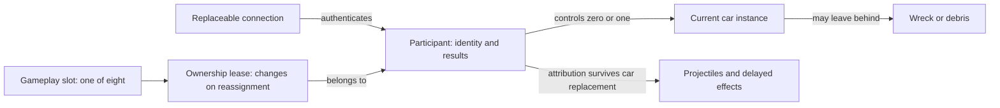
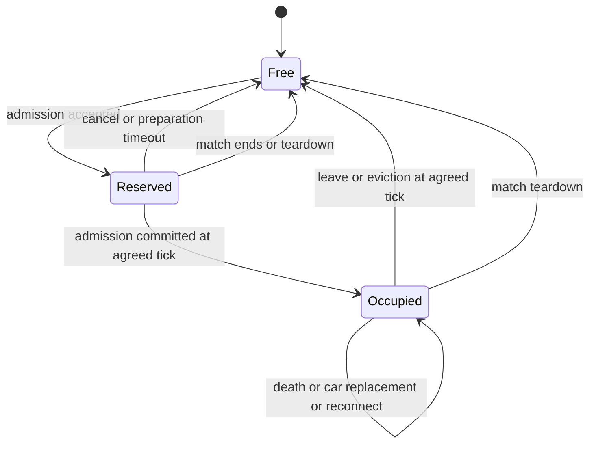
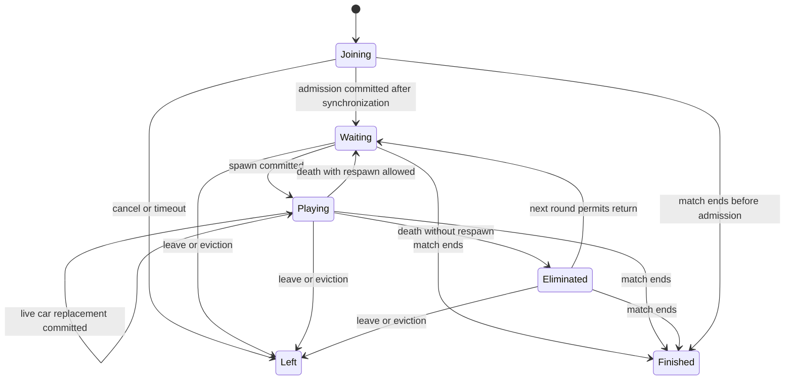
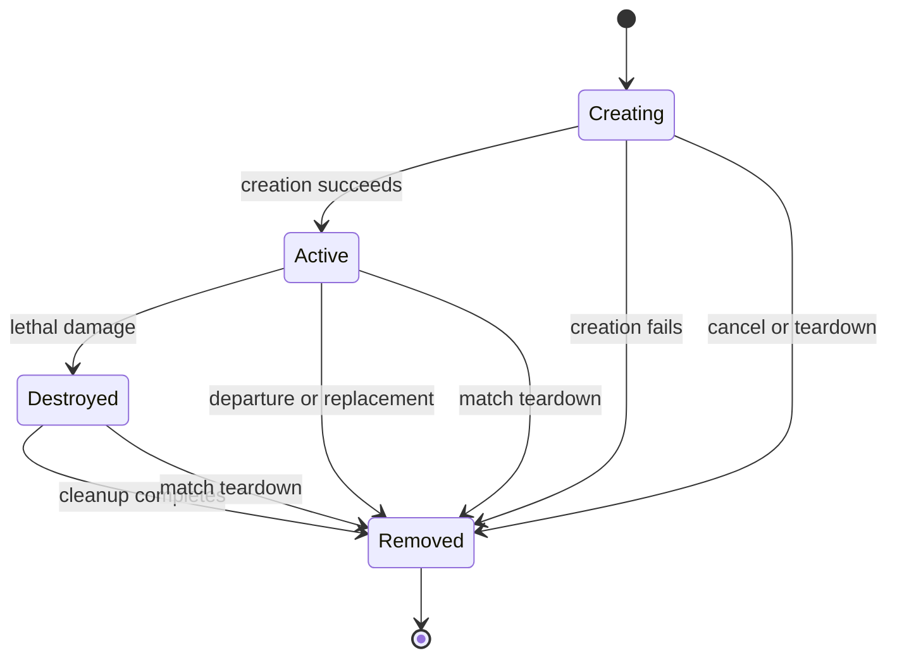
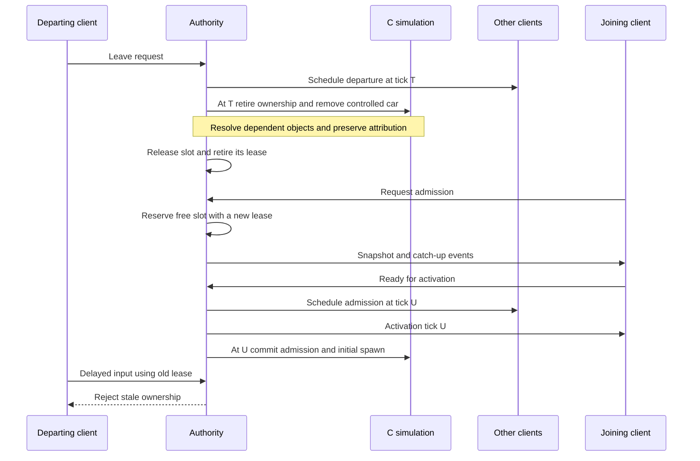

# Slots, participants and cars

Design and implementation boundaries for dynamic membership. This extends the identity
model in [network requirements v0.1](../network-requirements-v0.1.md). The first network
FFA builds on the live membership foundation. Offline modes retain the original rules.
Updated 2026-11-14.

## Evidence and scope

| Status | Boundary |
| --- | --- |
| Implemented foundation | Sparse gameplay slots, stable participant identity, C-owned combat results and car respawn; authoritative live admission, departure and reuse within the prepared model pool. |
| Recovery boundary | Current roster, car lifetimes and results restore through local rollback and portable checkpoints; committed membership decisions accompany accepted inputs in the server journal. |
| Implemented FFA policy | Eight gameplay slots; automatic random-model respawn; immutable time/frag limits and deterministic completion with ties. |
| Implemented room lifecycle | Authoritative named final scoreboard retained after private server release; return to the same room and fresh match startup in the loaded player. |
| Deferred mode policy | Map rotation, spectator seats and live replacement of a living car. |

The first agreed new mode is FFA: eight gameplay slots and joining and leaving
during play. Car selection belongs to the mode: FFA randomly selects from its prepared
pool on removal and may choose the same model again. Other modes below are design
cases, not commitments to implement them now.

## First FFA delivery boundary

The first network FFA uses its own round and participant rules while retaining the
original physics, weapons and collision. It does not emulate Tournament or the
original Deathmatch round organization. Standalone offline modes remain unchanged.

FFA rooms always offer eight player places, matching the eight gameplay slots; capacity
is not configurable. Two prepared participants can start, and later arrivals can join
the remaining places. The first increment uses C-owned participant frags/deaths and
a fresh randomly selected prepared car after death. Its explicit
startup parameter defaults to 90 simulation ticks (three seconds at 30 Hz), measured
from removal. It retries a failed spawn after 30 ticks, at most three attempts total.
Exhaustion leaves that participant in a terminal waiting state with identity, results
and lease retained; the player can explicitly leave and rejoin with a fresh identity.
Other participants continue. The client displays waiting and failure without owning
the policy or results.

FFA bypasses the original Deathmatch victory/transition driver: one or zero living
cars, or explicit departures, never end the round. The mode and delay are immutable
startup/journal data; portable roots validate the delay, and the existing C checkpoint
state contains all pending attempts. Lightyear restores and replays that same state.
Live admission, departure, slot reuse and recovery use the shared mechanisms.

FFA startup explicitly carries positive `timeLimitTicks` and `fragLimit`. Shared defaults
in `config/ffa.json` are 27,000 ticks (900 seconds at 30 Hz) or 20 frags, whichever comes
first. The start API can configure them; room controls currently display the defaults
without editing them. They are immutable once starting, validated by peers and portable
roots, and retained with the exact ordered model pool in the journal. Loading and resource
preparation advance no simulation ticks.

Membership commits before gameplay at a tick; FFA evaluates limits after all of that
tick's simulation and scoring. The result names the completed simulation tick, records
both reasons when both limits are reached, and preserves every occupied participant tied
for the highest frag count. Death count is not a tiebreaker. Disconnected occupied
participants remain eligible; departed participants retain the existing loss of score
eligibility. An empty roster has no winner. A last-tick admission that already committed
participates in that tick; unfinished reservations and future plans are cancelled.

Completion cancels pending respawns, rejects further admission and departure, and freezes
gameplay. Further diagnostic step calls may advance the timeline and controller samples,
but cannot change cars, scores or the recorded result. Local rollback and portable restore
include the result, and replay can cross the ending tick in either direction. No original
menu transition or continue-input path runs. A predicted end retains its client session
until confirmation. Membership forecasts beyond a provisional end stay queued without
changing C ownership; if correction undoes that end, native rollback applies them at their
original ticks through the ordinary identity checks. Invalid wire plans remain rejected,
and admission preconditions distinguish invalid decisions from constructor failure.
A client recovering at the boundary receives normal completion; an
authenticated reconnect after completion can retrieve the final result until teardown.

The authority seals the journal as finished and publishes `results`. Before releasing the
private server, Room reads its authenticated final-result API and persists one named result
with the match ID. That API binds C scores to the occupied participant identities and
private room credentials; credentials never appear in the public room result. Room keeps
immutable name receipts for match entrants so a departure racing the ending tick cannot
attribute a score to a replacement or erase the original name. Explicitly departed score
eligibility still follows the authority's committed roster.

The result remains available after server release and room reconnection. Return to room
reveals preparation controls while retaining the scoreboard. Preparation and its failures
retain the last result; starting the next roster clears it. The room resets readiness and
allocates a fresh private server for each match. The existing player frame retains its disc
and runtime, while session teardown closes transport, rollback/recovery callbacks and timers,
cancels C gameplay and removes completed recovery credentials. Room member IDs and names
survive; the fresh authority owns new match-local identities. Commands and player status are
match-scoped, and Room accepts results only for its current match ID. A stopped or failed
server does not become a successful completion.

Live replacement of an active car, transactional preservation of that car on failed
replacement, and general transformation policies are deferred. The broader FSMs
below retain those future cases as design constraints, not first-FFA acceptance.
Tournament compatibility is not a requirement for network FFA.

Portable car recovery now reconstructs runtime resources from the configured model
and registered callback descriptors, independently of the tick-zero car serial.
Current membership and its selected prepared models are canonical session roots.

## Relationships

A slot is capacity, a participant is identity, and a car is a simulation object.
These names describe contracts, not mandated new structs or fields. A lease means
that reuse must distinguish the previous owner from the next one, even if both use
the same numerical slot. Connection credentials and a car pointer cannot provide
that distinction by themselves.

## Preparation and live membership

The authority owns match-local participant IDs and unique gameplay-slot bindings,
separately from connection, recovery and command-acceptance state. A reservation
consumes a real free slot without publishing a C participant or car. Occupied and
reserved slots share the eight-seat capacity; cancelling preparation never renumbers
another slot. Participant IDs are never reused, including cancelled reservations.

Startup declares an ordered `modelPool`, separately from the occupied slots and their
initial cars. The authority preserves distinct initial choices in slot order, then fills
spare places in stock catalog order, up to eight models. Eight is the existing renderer's
permanent car-atlas capacity; choosing another initial stock model remains supported.
Every peer loads the complete declared pool before stepping. Atlas assignments remain
fixed so detached effects and debris retain their resources across model changes.
Admission can select any pool model; it cannot extend the pool, substitute an unavailable
model or load assets from another player. The newcomer prepares the complete pool from
their own local resources before restoring the current authority checkpoint and catching up.

After synchronization, admission commits at an authoritative simulation tick. C
prepares the mandatory camera and car resources before publishing the new ownership.
Failure restores canonical state, RNG and object serials, releases the reservation
and reports a preparation failure. Reservations and catch-up have bounded deadlines;
round completion or match end cancels unfinished admission. Explicit room leave is
idempotent when a failed preparation has already released its reservation. The room
checks pending leases on the simulation thread, clears canceled grants and readiness,
and permits the same member to retry with a fresh credential and identity. Monitoring
failures preserve the grant until an authoritative response arrives; committed leases
remain intact across transport loss. Initial clock negotiation
and tick-zero digest agreement do not run again for a live member.

Explicit departure removes the current car through ordinary object destruction,
retires connection authorization and credentials, discards queued commands and input
history, and releases the actual slot. Re-entry gets a fresh identity, controls and
zero results. The current foundation ends departed combat-score eligibility; copied
provenance remains on old effects and cannot award the replacement occupant. It does
not add a departed-player scoreboard.

A transport loss, hidden tab or recovery request does not schedule departure. The
existing recovery policy retains that occupied lease until explicit departure or match
end; choosing a shorter reconnect grace and eviction policy remains mode work.
Authenticated recovery keeps identity, results, slot and the input sequence watermark.
Rebinding the connection discards raw commands left by its predecessor. Input acceptance
checks participant identity, current native controller entity and connected owner, in
addition to Lightyear's target authorization.

C player roots, pads, camera/HUD ownership and results use actual sparse slots. The
dense car list and entrant indices describe simulation objects and may be rebuilt when
membership changes; they never identify a participant. Human car resources are prepared
for the declared slot capacity, so a larger live roster cannot overrun initial-count
allocations. A reserved local seat has no viewport or listener until its camera exists.
Standalone offline startup and round rules retain their original behavior.

Stable participant IDs also cross the startup boundary into C. C owns combat
counters independently of the current car; Rust and browser code do not maintain a
second score authority. The native controller bindings must match those supplied
to C. Detached weapon effects receive copied provenance explicitly; ordinary owned
children inherit their owner's identity. Timed secondary-wave callbacks capture identity
values, independently of process/interaction/destruction context. Burning retains
its source on the car after the originating effect or car disappears. Each accepted
external ignition or refresh replaces that source, including zero for environmental
fire; contact with the car's own attached flame does not refresh it. Shielded/frozen
ignitions do not change it. This is provenance for one burning interval, not an
assist or generic last-attacker system. AI damage reaction keeps its original
attacker argument. The participant-aware raw damage export has a distinct name;
the old calling convention is not silently accepted. Offline Deathmatch retains its round wins/losses and victory rules; network FFA
publishes the participant combat counters directly.

### Same-participant respawn foundation

Removal clears the current car and its weak references while retaining the participant,
lease and combat results. A mode may request a fixed-model respawn at a simulation tick,
with an explicit retry interval and attempt budget (at most eight attempts). A failed
attempt leaves no active car binding; exhaustion retains a terminal waiting state until teardown.
Both collision polyhedra and successful camera attachment are mandatory before publication.
Optional turbo visuals or engine audio may be absent without disabling simulation. Successful
creation registers a fresh object serial and rebinds the existing player and camera roots. No car-local health, inventory, capture state or burning interval transfers.
Old detached damage effects retain their copied participant provenance.

Waiting, scheduled and exhausted requests are C-owned canonical state, included in local
checkpoints and portable session roots. Portable recovery supports dead/waiting participants,
new car lifetimes and their debris; resource preparation creates no duplicate runtime children.
FFA selects exactly once after successful respawn scheduling at removal, in deterministic
car-removal order. Selection uses the saved gameplay RNG and rejection sampling of its
15-bit draws, uniformly across the ordered pool; even a one-model pool consumes a draw.
Explicit departure does not select a respawn.
The chosen pool index is canonical immediately, including while waiting. Retries never
reroll. Failed constructors restore gameplay/effect RNG and object serials to their
pre-attempt values; they retain the selected model, identity, results and lease.
Portable roots validate the exact pool membership and order before reconstructing cars.
Constructor RNG consumption otherwise follows the existing state paths.

FFA schedules the shared respawn operation when removal commits. The original-rule
and manual-respawn startup entry point exists only in diagnostic builds for focused
foundation fixtures. Production network startup accepts FFA only. Live replacement
remains deferred; offline round rules are unchanged.

## Authoritative event boundary

Membership uses the existing Lightyear clock, reliable session channel, input buffers
and C rollback checkpoints. A scheduled batch is the complete ordered membership plan
for one tick; an empty replacement cancels its pending changes. At that tick, departures
precede admissions in slot order, then accepted inputs and ordinary gameplay run.
C still decides combat deaths; the selected mode owns respawn and round policy.

A reserved controller has no accepted gameplay input history. Admission establishes its
neutral pre-activation boundary; retirement preserves the old native history for the
retained rollback window while preventing future control. Late plan changes request
Lightyear rollback, or current-snapshot recovery when the boundary has expired. The
browser never runs an independent membership clock.

The final decisions are recorded with their input row and stable model selection in
the checksummed journal. Recovery sends the current checkpoint plus its event/input
suffix and future scheduled plans. Portable roots validate the immutable initial match
identity and prepared resources independently from the mutable current roster, allowing
restoration after admission, departure, reuse or car respawn in another instance.

## Slot FSM

`Reserved` consumes capacity while a new participant catches up. It is not a car.
A temporary disconnect keeps an occupied slot during the reconnect grace period.
Death does not release the slot. Expiry and explicit leave release it according to
the mode's departure policy, not merely when a socket closes.

## Participant FSM

Connection state is independent: connected, disconnected within grace, or expired.
A disconnected participant can still be killed or win the match. Reconnection
restores their current state; it does not revive the car or reset results.
`Waiting` includes respawn delay and waiting for an eligible round. A spectator
without a gameplay seat is a separate future policy, not an eliminated player.

`Left` and `Finished` stop participation in this match. Results and effect
attribution may outlive them. Room membership and the next match have separate
lifetimes; returning to the room must not reuse the old match's control lease.
Explicit leave followed by re-entry creates a new participant with fresh results,
even for the same person. It cannot reclaim the departed participant's identity.
This differs from authenticated recovery after a temporary connection loss.

## Car FSM

Respawning or replacing a live car starts a new logical car lifetime, even if the
implementation reuses storage. A wreck can coexist with its owner's replacement
car. Capture, stun and immobilization are gameplay conditions of an active car;
they do not transfer participant ownership.

## Composing the FSMs

These are valid committed states. Creation may be prepared internally, but partial
ownership changes must not become visible to gameplay or snapshots.

| Participant | Slot relationship | Current controlled car |
| --- | --- | --- |
| Joining | One reservation | None |
| Waiting | One occupied lease | None; old wrecks may remain |
| Playing | One occupied lease | Exactly one active instance bound to that lease |
| Eliminated | One occupied lease | None; a spectator view does not grant control |
| Left | No reservation or lease | None; attributed effects may remain |
| Finished | No reservation; an occupied slot may remain until teardown | No gameplay control; final scene objects may remain until teardown |

Admission atomically commits `Reserved → Occupied` and `Joining → Waiting` at its
authoritative tick. A successful initial spawn may enter `Playing` at that same
tick; a mode may instead keep the participant waiting for an eligible round.
Failed admission does not publish half of this transition.

Live replacement atomically changes the current car while keeping `Playing`, its
slot lease and participant identity. Until it succeeds, the old car remains the
current instance. Death transitions to `Waiting` or `Eliminated` and removes
control of the destroyed car without releasing the slot.

Explicit departure retires the lease together with control of the car. Match end
cancels pending reservations and disables gameplay control; teardown frees all
remaining slots and cancels any unfinished creation. No activation may commit
after the match has ended.

## Mode policies

| Mode | Join during play | After death | Departure consequences |
| --- | --- | --- | --- |
| FFA, first increment | Reserve any free seat, catch up, spawn | Keep results and slot; fresh random pool model after the configured delay | Free seat; old effects never become the next occupant's |
| Diagnostic original-rule fixture | Prepared-pool admission while the round is active | Existing game rules | Retire at the event tick; original victory rules can finish the round |
| Team deathmatch, candidate | Also assign a team | Preserve team and results | Preserve team results independently of occupancy |
| Capture the flag, candidate | Also assign a team | Respawn under mode rules | Resolve a carried objective before removing the car |
| Elimination or limited lives, candidate | May wait for the next round | Wait, spend a life or become eliminated | Decide forfeit and victory rules explicitly |
| Duel, candidate | Queue when both seats are occupied | Mode-specific | Decide forfeit and promotion from queue |
| Tournament, candidate | Must respect the existing stage and roster rules | Keep the assigned car model under the stage's respawn rules | Distinguish leaving a match from leaving the tournament |

Mode rules decide admission, car selection, respawn and scoring. The shared
lifecycle mechanism does not hardcode random selection or couple replacement to
death. A mod event may replace a living participant's car during play.

### Car selection and replacement

The mode chooses the model and replacement timing, including initial spawn,
respawn and live transformations. It also specifies what happens to car-local
state: health, weapons, velocity, position and active attachments. These are not
automatically copied wholesale. A car replacement itself preserves participant
identity, results, team and slot; other mode events may change those separately.

The common operation validates the model, prepares the instance, resolves dependent
references and commits the replacement at an authoritative tick. It updates the
local view without reassigning the participant. Existing projectiles retain their
original attribution. Failure leaves no partial replacement or constructor side
effects, including changes to gameplay RNG state.

Random selection may return the previous model. It uses an agreed available pool
and must reproduce the same choice after rollback, through deterministic state or
a recorded authoritative decision. Model identities must not depend on local
resource enumeration order.

Every simulating peer and the authority must have compatible gameplay resources
for that pool before a model can be used. Late admission validates the newcomer
against the active pool, not just their selected car. Extending the pool during a
match requires resource readiness before activation; it must not stall the other
players or silently substitute a model. The resource distribution constraints in
the network requirements still apply.

Failure handling distinguishes three cases:

- Failed admission abandons and releases its reservation, or retries within a
  bounded admission deadline.
- Failed respawn leaves the participant in `Waiting` with their results and
  occupied slot intact. The mode must define bounded retries and a terminal policy.
- Failed live replacement leaves the original car and its participant binding
  unchanged. A later retry is a new scheduled attempt.

## Leaving and reusing a slot

This is the target logical ordering, not a proposed wire protocol. The server
continues simulating during catch-up. Membership changes belong to the simulation
timeline, snapshots and journal so prediction can replay across them. Snapshot
recovery must include every membership event after its captured state.

## Invariants

1. A slot has at most one current owner. A participant has at most one reservation
   or occupied lease. Reserved plus occupied slots cannot exceed the mode's
   capacity; disconnected and eliminated owners still consume their seats.
2. Input is valid only for its match, ownership lease and tick. Slot reuse cannot
   make delayed input from a previous owner valid again.
3. A participant controls at most one active car in these modes. Score, team and
   reconnect identity survive replacement of that car.
4. Leaving and disconnecting are different events. A second connection must not
   accidentally create a second participant or release the first one's seat.
   After explicit departure, re-entry creates a new participant. A new occupant
   inherits none of the previous occupant's results, team assignment, input history
   or per-participant timers; the mode initializes them afresh.
5. Death and departure detach references safely. Damage attribution is not a
   dereference of a destroyed car, nor a lookup of whoever now occupies its slot.
6. Camera, HUD and audio follow the local participant's current view target. A
   vacant slot or destroyed car must not leave a dangling presentation reference.
7. Failed admission, allocation or restore leaves a valid state and releases any
   reservation it abandons. Restore failure must not partially rewrite live state.
   Respawn failure does not erase the existing participant. Live replacement
   failure does not destroy their original car.
8. All peers apply the same membership and gameplay event order. Snapshots and
   rollback preserve ownership, random choices and dependent object lifetimes.
9. Ending a match fences off its pending admissions, input and recovery attempts.
   Events from it cannot modify the next match.

## Scenario matrix

Each row supplies a test case. Apply relevant cases in ordinary execution, across
a rollback boundary, and after portable snapshot recovery in another instance.

| Situation | Required observation |
| --- | --- |
| New player joins an active match | Existing players continue; newcomer controls only their assigned car after activation |
| Two players request the last seat | Exactly one reservation succeeds |
| Joiner times out or cancels | No orphan car or occupied reservation remains |
| A middle slot leaves while higher slots remain | No compaction changes another participant's identity or controls |
| Leave followed by immediate slot reuse | Late input and messages from the old lease cannot affect the newcomer |
| The same person leaves explicitly and joins again | New participant identity and fresh results, with no inherited slot-local input or timers |
| A projectile hits after its owner leaves or respawns | Attribution stays with the original participant, subject to scoring policy |
| Car dies while its client is disconnected | Reconnect restores death, respawn or elimination as it actually occurred |
| Client reconnects after grace expiry and slot reuse | Old credentials cannot reclaim the new occupant's car |
| Duplicate tabs or delayed disconnect notification | Only the accepted controller owns input; stale disconnect cannot evict its replacement |
| Captured car or objective carrier leaves | Dependent references and mode objectives are resolved without dangling pointers |
| Kill, leave and match-ending score occur on one tick | The agreed ordering produces one result on authority, rollback and recovery |
| Admission or snapshot restoration fails | State remains valid, no partial FSM transition survives, abandoned reservation is released |
| Respawn creation fails | Results and occupied slot survive, bounded retry or terminal mode policy runs |
| Deferred: live replacement fails | Original car, binding and gameplay RNG state are unchanged |
| Match ends during reservation, creation or recovery | Pending operations are cancelled, teardown frees slots, the next match starts cleanly |
| Respawn chooses a random car, including the same model | Replay selects the same model, starts a new car lifetime and preserves participant results |
| Shared fixed-model respawn foundation | Same identity/results/lease, fresh serial; rollback and portable continuation across death, waiting and respawn |
| Deferred: a mod replaces a living car | Participant stays Playing with the same lease and results, car-local state follows replacement policy |
| Deferred: live replacement occurs while the client is disconnected | Recovery restores the actual replacement rather than the client's previous model |
| Requested model is unavailable or incompatible on a peer | Admission or pool extension is rejected before activation without stopping existing players |

## Decisions still needed

- A shorter reconnect grace and eviction policy; the current foundation retains
  disconnected leases and applies the existing bounded missing-input policy.
- FFA scoring of hits from departed participants and retention of departed results;
  current validation ends their score eligibility and never transfers attribution.
- Spectator capacity, late admission into round-based modes, and minimum players
  needed to start or continue an otherwise empty match.
- Retry and preservation policy for future live replacement. FFA respawn has the
  bounded terminal-waiting policy above.
- Car-local state transfer rules for each live replacement event, including
  capture links and carried objectives. These belong to the mode or mod.

Resolve these as mode policies and test expectations before implementing the
corresponding transitions. The FSMs alone do not settle those choices.
