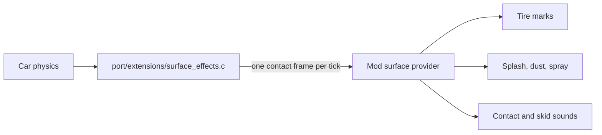

# Surface effects

`world/surfaceEffects` is a type-2 symbol resolving to `Rm4SurfaceEffects` from
[`surface_effects.h`](../../port/extensions/surface_effects.h). Omit it for TM4
behaviour. An unresolved symbol or unsupported descriptor version fails loading.
The provider applies to all cars on the map, independently of their special attacks.
`RM4_SURFACE_REPLACE_CONTACT_AUDIO` explicitly replaces the engine's impact and
suspension landing sounds. With no flags, visual effects retain TM4 audio.
A non-string resource, unknown flags, an incompatible version or size, or missing
callbacks fail loading. Audio replacement does not bypass the existing landing
guard or change the vibration/countdown operations in that branch.

The engine computes contacts after physics, including material, position, normal,
movement, slip and suspension compression. Contact masks expose begin/end and
landing transitions. The impact event comes from the existing collision detector.
The physics hooks record impact speed and suspension compression through the adapter;
the reconstructed physics does not write provider state or interpret mod resources.
Compression is observation only: the mod may choose when to play a landing sound;
it cannot change physical contact, friction, suspension or controller vibration.

Each car owns one registered provider instance. The engine invokes it directly;
its class has no process callback. This leaves `Car.process_callback` available
for the car's special attack. Teleport/reorientation resets the provider and breaks
marks; stale contacts from that physics step are discarded. Destroying the car
also destroys its instance and owned marks. Unattached particles finish normally.

Instances, marks and particles use ordinary object snapshot schemas. The car stores
a weak object reference and the previous contact mask; physics scratch is transient.
The field schema and checksum writer live together in
[`surface_effects_state.c`](../../port/extensions/surface_effects_state.c).
Restoring a snapshot restores the object graph, without rerunning provider attachment.
Callbacks run during replay too, so all persistent effect state needs snapshot fields.
Cosmetic randomness uses the engine effect stream (`randrand`), which is saved and
restored with the session. It must not advance the gameplay stream (`rand`).
Mod audio opts into the same stream with the `RM4_SOUND_EFFECT_RANDOM` constructor
flag from `port/extensions/sound.h`; stock emitters keep their original RNG choice.

The TM3 provider lives in `src/shared/world/surface.c` in the mod repository.
Its `tm3WheelSurface` instance creates `tm3TireMark` and `tm3SurfaceParticle` objects.
`world/wheelMaterials` and `world/wheelAtlas` remain private TM3 payloads: the engine
never interprets their records. Marks end on lost contact, material change or reset.
The old `wheelSurfaceClass` and `contactEffects` hooks have been removed.
