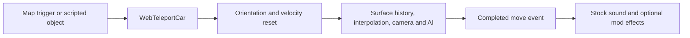

# Teleport extension

The port owns relocation; maps own triggers and presentation. The ordinary
`teleporter` interaction and custom mod objects use the same `WebTeleportCar`
operation from [teleport.h](../../port/extensions/teleport.h).



A request supplies destination world coordinates, a forward vector in Q12 and
an optional source object. Null requests/cars and directions without a horizontal
component are rejected before any mutation. The existing TM4 orientation routine
normalizes the basis and clears particle and wheel velocities. Teleportation is
not an arbitrary matrix assignment: it also cuts interpolation/surface history,
snaps the controlling camera when present, and notifies AI.

`world/teleportEffects` is an optional type-2 symbol resolving to an immutable
`Rm4TeleportEffects` descriptor. It is resolved and validated on car-class load
and released on class unload. Wrong resource types, unsupported versions/sizes,
unknown flags and missing callbacks fail loading.

The callback receives the car, optional source, and before/after transforms after
relocation completes. References are borrowed for that call. It creates effects,
not another relocation or destruction of the affected car. `RM4_TELEPORT_REPLACE_AUDIO`
explicitly replaces the two original TM4 post-move sounds; without it, custom
visual effects coexist with stock audio. Without a descriptor, stock audio remains.

## Portal appearance

| Instance resource | Meaning |
| --- | --- |
| `appearance` omitted or string `original` | Original animated portal; needs portal textures. |
| `appearance` string `none` | Invisible interaction trigger; needs no portal textures. |
| `appearance` string naming a registered object class | Owned mod visual; needs no portal textures. |

A custom appearance is an ordinary registered class selected by name at portal
construction. Its packed constructor receives one `const Rm4TeleportAppearanceContext*`
after the engine consumes the owner argument. Copy needed values during construction.
The context contains entrance position, destination, forward direction, radius and the
instance registry for map-authored visual settings. Do not retain the context pointer.

For a Minecraft-style portal, a map instance can specify:

```text
appearance = "minecraftPortalVisual"
```

The mod registers its visual class before map instances load:

```c
ObjectRegisterClass("minecraftPortalVisual", sizeof(MinecraftPortalVisual), registry,
    (Tm4PackedConstructor)PortalConstruct, NULL,
    (Tm4ObjectCallback)PortalProcess,
    (Tm4ObjectDisplayCallback)PortalDisplay,
    (Tm4ObjectCallback)PortalDestroy);
```

`PortalConstruct` reads the context and initializes the frame/plane geometry;
`PortalProcess` advances animation; `PortalDisplay` draws the frame and purple surface.
The class also registers its normal snapshot schema. Assets and custom rendering stay
in the mod. Selecting an appearance does not change trigger geometry: the stock portal still
uses its interaction radius, not the rendered rectangle.

The port creates the visual after the trigger initializes, with the trigger as owner
and `OBJECT_FOLLOW_OWNER | OBJECT_DESTROY_WITH_OWNER`. The visual inherits the portal
position before its constructor runs. The engine handles
processing, drawing, deletion and owner references; no second rendering loop or visual
pointer in the portal is needed. Arrival effects remain a separate `teleportEffects`
callback, because they happen on crossing rather than throughout the portal lifetime.

Wrong resource types, empty names, unknown classes or failed visual construction fail
portal construction. Default colour uses persistent class data, not a local variable.

## Replay and ownership

No deferred teleport queue or separate simulation state is added. On replay the
operation runs again at the same simulation point. The destination/appearance of
ordinary placed portals are immutable template resources; mod triggers with mutable
exit selection must include that state in their own snapshot schema.

Both portal and owned appearance can be removed and restored. Restore rebuilds the
owner link from snapshot data without rerunning visual constructors. Mutable animation
belongs in the visual class schema; rendering scratch state must be transient.

Effect objects use ordinary snapshots; sounds use the existing rollback audio
lifecycle. Restoring a snapshot does not emit a new arrival event. Relocation resets
surface history through `CarOrientWithMatrix`; the teleport adapter does not reset
it a second time.

TM3 selects `appearance = none` and exports `Tm3TeleportEffects`. Its callback plays
`tm3_s11` on the arriving car. The converter preserves original entrance/exit data.
The previous singular callback and implicit colour-based visibility are removed;
rebuild the shared MR and map MR archives together with the player.

## Checks

Build `tm4_teleport_check` and run its `.cjs` output with Node. It exercises real
matrix normalization and portal construction, appearance with/without textures,
invalid requests, camera ownership, default/replaced audio and callback ordering.
Arguments `version`, `size`, `flags`, `callback`, `type` exercise provider rejection
and must terminate with the corresponding diagnostic and a nonzero exit status.
The TM3 browser surface test covers the actual portal interaction, broken tire
marks and equivalent local/portable replay through the move.

The TM3 `tests/browser/teleport-appearance.mjs` fixture selects a diagnostic appearance
through map resources, checks normal creation/process/ownership/destruction, and compares
replay hashes after local rollback and fresh-match portable restore. A second portable
snapshot verifies that removed portals and visuals stay removed. The diagnostic class
is excluded from production modules.
